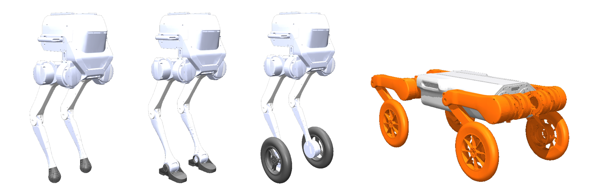
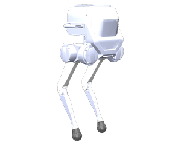
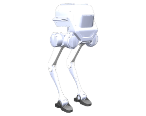
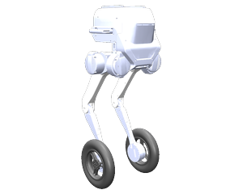
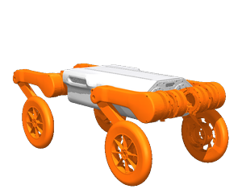

<div align="center">

**English** | [中文](README_cn.md)

# TRON1 Robot Description

**Open, simulation-ready robot models for the LimX Dynamics TRON1 biped — point-foot, sole-foot and wheel-foot — plus a wheel-legged quadruped.**

URDF · Xacro · MuJoCo MJCF · ROS 1 · ROS 2 · Gazebo

[](LICENSE)
[](http://wiki.ros.org/noetic)
[](https://docs.ros.org/en/iron/)
[](https://mujoco.org/)
[](https://gazebosim.org/)
[](https://github.com/limxdynamics/tron1-robot-description/stargazers)



<sub>Rendered directly from the MJCF / URDF files in this repository.</sub>

</div>

> **Part of the TRON1 open-source ecosystem** — from robot model to training, sim-to-sim and real-robot deployment. See the [ecosystem map](https://github.com/limxdynamics/tron1-rl-isaacgym#tron1-open-source-ecosystem).

## Why this repo

- **One TRON1, three feet.** Swap between point-foot, sole-foot (with ankle) and wheel-foot by changing one model name.
- **Load it in 30 seconds.** Every biped variant ships a MuJoCo MJCF — `pip install mujoco` is all you need, no ROS required.
- **Same models, every toolchain.** URDF, Xacro and MJCF from one source, working with ROS 1 Noetic, ROS 2 Iron, Gazebo and MuJoCo.
- **Built for sim-to-real.** These are the models used across the official TRON1 training ([Isaac Lab](https://github.com/limxdynamics/tron1-rl-isaaclab) / [Isaac Gym](https://github.com/limxdynamics/tron1-rl-isaacgym)), simulation and deployment stack.
- **Gazebo and ros2_control wiring included.** Transmissions and the Gazebo IMU sensor plugin are
  emitted by default; the `ros2_control` hardware block and the `gazebo_ros2_control` plugin come with
  `use_gazebo:=true`.

## Try it in 30 seconds (no ROS)

```bash
git clone https://github.com/limxdynamics/tron1-robot-description.git
pip install mujoco
python -m mujoco.viewer --mjcf=tron1-robot-description/pointfoot/WF_TRON1A/xml/robot.xml
```

Swap `WF_TRON1A` for any biped model in the table below — all eight ship an MJCF. The wheel-legged
quadruped (`WL_P311D` / `WL_P311E`) ships URDF and SRDF only, so it has no `xml/robot.xml`. Or load
it from Python:

```python
import mujoco

model = mujoco.MjModel.from_xml_path("tron1-robot-description/pointfoot/SF_TRON1A/xml/robot.xml")
data = mujoco.MjData(model)
mujoco.mj_step(model, data)
```

## Robot models

| | Type | Models | Actuated DoF | Formats |
|:-:|---|---|:-:|---|
|  | **Point-foot** biped | `PF_TRON1A` `PF_TRON1B`<br>`PF_P441A` `PF_P441B` `PF_P441C` `PF_P441C2` | 6 | URDF · Xacro · MJCF |
|  | **Sole-foot** biped (with ankle) | `SF_TRON1A` `SF_TRON1B` | 8 | URDF · Xacro · MJCF |
|  | **Wheel-foot** biped | `WF_TRON1A` `WF_TRON1B` | 8 | URDF · Xacro · MJCF |
|  | **Wheel-legged** quadruped | `WL_P311D` `WL_P311E` | 16 | URDF · SRDF |

<details>
<summary><b>Repository layout</b></summary>

```text
tron1-robot-description/
├── pointfoot/                 # TRON1 biped family
│   ├── <MODEL>/
│   │   ├── urdf/robot.urdf    # flattened URDF
│   │   ├── xacro/             # robot.xacro + gazebo / transmission / ros2_control
│   │   ├── xml/robot.xml      # MuJoCo MJCF
│   │   └── meshes/            # STL meshes
│   └── meshes_camera/         # optional Intel RealSense D435 mesh (referenced from a commented-out
│                              # block in every *_TRON1A / *_TRON1B model)
├── wheellegged/
│   └── <MODEL>/{urdf,srdf,meshes}
├── CMakeLists.txt             # builds as package `robot_description` on ROS 1 and ROS 2
└── package.xml
```

</details>

## Use with ROS

The repo builds as a single ROS package named **`robot_description`** on both ROS 1 and ROS 2. The workspace and the clone are the same for both, so run this once and then open the block for your ROS version:

```bash
mkdir -p ~/limx_ws/src && cd ~/limx_ws/src
git clone https://github.com/limxdynamics/tron1-robot-description.git
cd ~/limx_ws
```

<details open>
<summary><b>ROS 1 (Noetic)</b></summary>

```bash
source /opt/ros/noetic/setup.bash
catkin_make install
source devel/setup.bash

# Choose your robot, e.g. SF_TRON1A
export ROBOT_TYPE=SF_TRON1A

# Generate the URDF from Xacro
rosrun xacro xacro $(rospack find robot_description)/pointfoot/$ROBOT_TYPE/xacro/robot.xacro
```

</details>

<details open>
<summary><b>ROS 2 (Iron)</b></summary>

```bash
source /opt/ros/iron/setup.bash
colcon build --cmake-args -DCMAKE_BUILD_TYPE=Release
source install/setup.bash

export ROBOT_TYPE=SF_TRON1A
xacro $(ros2 pkg prefix robot_description)/share/robot_description/pointfoot/$ROBOT_TYPE/xacro/robot.xacro
```

</details>

**Xacro arguments** (biped models):

| Argument | Default | Effect |
|---|---|---|
| `use_gazebo` | `false` | Adds the Gazebo `ros2_control` hardware block (`PointFootHWSim`) with joint and IMU interfaces |
| `use_support` | `false` | Fixes the base to the world 0.3 m above ground — handy for debugging joints in the air |

```bash
xacro .../pointfoot/$ROBOT_TYPE/xacro/robot.xacro use_gazebo:=true
```

> **Note:** `use_gazebo:=true` expands `$(find pointfoot_gazebo)` to locate the controller config, and
> `pointfoot_gazebo` is not part of this repository — without it installed, `xacro` stops at that line
> with a package-not-found error. Everything else in this table needs only the files here.

> **Tip:** the flattened URDFs reference meshes as `package://robot_description/...`. Outside ROS (e.g. Isaac Sim, PyBullet, Pinocchio), point your loader's package path at this repo's parent folder, or use the MJCF files directly.

## TRON1 ecosystem

```text
tron1-robot-description ──► tron1-rl-isaaclab / tron1-rl-isaacgym ──► tron1-mujoco-sim ──► tron1-rl-deploy-* ──► real TRON1
     (you are here)                     (train)                         (sim-to-sim)           (deploy)
```

| Stage | Repository |
|---|---|
| Train | [tron1-rl-isaaclab](https://github.com/limxdynamics/tron1-rl-isaaclab) (recommended) · [tron1-rl-isaacgym](https://github.com/limxdynamics/tron1-rl-isaacgym) |
| Simulate | [tron1-mujoco-sim](https://github.com/limxdynamics/tron1-mujoco-sim) · [tron1-gazebo-ros](https://github.com/limxdynamics/tron1-gazebo-ros) · [tron1-gazebo-ros2](https://github.com/limxdynamics/tron1-gazebo-ros2) |
| Deploy | [tron1-rl-deploy-python](https://github.com/limxdynamics/tron1-rl-deploy-python) · [tron1-rl-deploy-ros](https://github.com/limxdynamics/tron1-rl-deploy-ros) · [tron1-rl-deploy-ros2](https://github.com/limxdynamics/tron1-rl-deploy-ros2) |

**No robot yet?** Run the pre-trained policies from `tron1-rl-deploy-python` inside `tron1-mujoco-sim` — nothing to train.

## License

[Apache License 2.0](LICENSE) © LimX Dynamics
